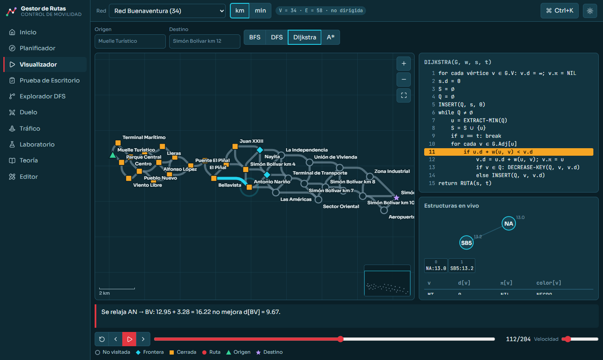
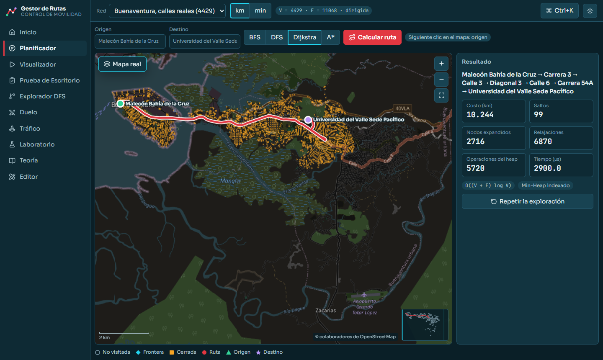

# Gestor de Rutas de Transporte

Proyecto de **Análisis y Diseño de Algoritmos I (750008C)**, Universidad del Valle – Sede Pacífico, 2026-2. Docente: Esteban Andrés Díaz Mina.

Simula una red de transporte público como un grafo y compara BFS, DFS, Dijkstra y A* con estructuras de datos propias: cola circular, pila, lista de adyacencia, montículo binario indexado, tabla hash y árbol k-d. No usa ninguna librería de grafos.



## Lo que incluye

- **Planificador** de rutas con los 4 algoritmos, en km o minutos.
- **Visualizador** paso a paso con pseudocódigo, inspector de estructuras y narración.
- **Prueba de Escritorio** de la red de 8 estaciones, comparada con la tabla del docente.
- **Explorador DFS:** rutas simples, conectividad y puntos críticos con Tarjan.
- **Duelo** Dijkstra contra A*, con validador de heurística y A* ponderado.
- **Centro de Tráfico:** ordenamiento, estadísticas, top-k, incidentes y re-ruteo.
- **Laboratorio** de complejidad con Web Worker y curvas teóricas ajustadas.
- **Modo Sustentación**, teoría integrada, editor de redes y CLI de respaldo.
- **Buenaventura con calles reales:** 4429 cruces y 5765 tramos tomados de OpenStreetMap, con las calles de un solo sentido como vías dirigidas. El botón de capas del mapa elige el fondo: esquema, calles guardadas o el mapa real de OpenStreetMap.

Todo funciona sin internet. Solo el fondo "Mapa real" necesita conexión; sin ella, la app vuelve sola a las calles guardadas.



## Forma rápida de probarlo

En línea, desde cualquier computador o celular: **https://gestor-rutas-ada.cristian-david-rios.workers.dev**

Sin internet: abre `GestorRutas.html` con doble clic. No hace falta instalar nada.

## Instalación en Windows

Necesitas [Node.js](https://nodejs.org) 20 o superior. Compruébalo en PowerShell:

```powershell
node -v
```

En la carpeta del proyecto:

```powershell
npm install
npm run dev
```

Abre la dirección que aparece en la terminal, normalmente `http://localhost:5173`.

## Scripts

| Comando | Qué hace |
|---|---|
| `npm run dev` | Servidor de desarrollo |
| `npm run build` | Genera `dist/` y `GestorRutas.html` |
| `npm test` | Pruebas |
| `npm run coverage` | Pruebas con cobertura de `src/core` |
| `npm run typecheck` | Revisión de tipos |
| `npm run lint` | ESLint |
| `npm run check` | Tipos, lint, pruebas y build |
| `npm run bench` | Benchmarks; escribe `bench/resultados/` e `informe/figuras/` |
| `npm run cli -- ayuda` | CLI de respaldo |
| `npm run capturas` | Capturas de la app y prueba de humo |
| `npm run informe` | Informe técnico en PDF |
| `npm run informe:fase1` | Documento de la Fase 1 en PDF |
| `npm run entrega` | Genera el `.zip` de entrega |
| `node scripts/osm-descargar.mjs` | Vuelve a descargar las calles de Buenaventura de OpenStreetMap (necesita internet) |
| `node scripts/osm-convertir.mjs` | Convierte esa descarga en `src/redes/buenaventura-osm.json` |

`npm run informe` y `npm run capturas` usan el Edge o Chrome instalados. Si el PDF falla, queda `informe/salida/Informe_Tecnico.html`, listo para imprimir desde el navegador.

## Antes de entregar

1. Completa los datos en `proyecto.config.json`.
2. Pon el logo en `public/logo-univalle.png`.
3. Ejecuta, en este orden:

```powershell
npm run bench
npm run build
npm run capturas
npm run informe
npm run informe:fase1
npm run entrega
```

## Estructura

```
src/core/       TypeScript puro, sin dependencias: estructuras, grafo, algoritmos, tráfico
src/redes/      Presets: docente, fase 1, Buenaventura simulada y calles reales (OSM)
src/ui/         Interfaz en React
src/workers/    Worker del laboratorio
src/cli/        CLI de respaldo
tests/          Pruebas, incluida la auditoría de pureza
bench/          Benchmarks y resultados
informe/        Fuentes y construcción del informe
docs/           Guía de sustentación, arquitectura y manual
scripts/        Build, verificación, capturas y entrega
```

Más detalles en [docs/ARQUITECTURA.md](docs/ARQUITECTURA.md), [docs/MANUAL_USUARIO.md](docs/MANUAL_USUARIO.md) y [docs/GUIA_SUSTENTACION.md](docs/GUIA_SUSTENTACION.md).

La Red Buenaventura es una red simulada con fines académicos, con coordenadas aproximadas.

La red "Buenaventura, calles reales" y su fondo de costa, agua y manglar usan datos © [colaboradores de OpenStreetMap](https://www.openstreetmap.org/copyright), disponibles bajo la licencia [Open Database License (ODbL)](https://opendatacommons.org/licenses/odbl/). Los archivos `src/redes/buenaventura-osm.json` y `src/redes/buenaventura-osm-fondo.json` son una base de datos derivada y se distribuyen bajo esa misma licencia. El mapa real que se ve con internet son teselas de [openstreetmap.org](https://www.openstreetmap.org).
