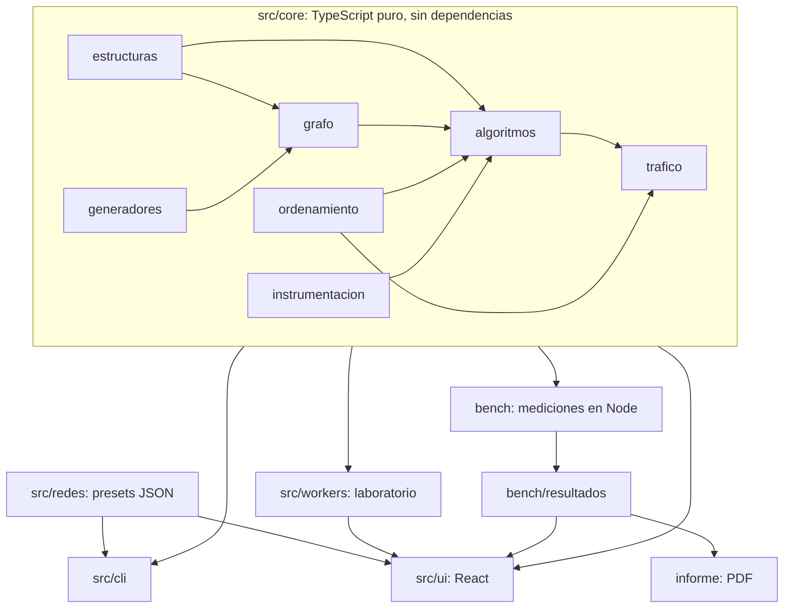

# Arquitectura

## Módulos

Las dependencias van en un solo sentido: todo usa `core` y `core` no importa nada de afuera. `tests/auditoria-pureza.test.ts` lo verifica leyendo el código fuente.

## Decisiones

**Un solo código.** La interfaz, los benchmarks, el CLI y las pruebas ejecutan las mismas funciones. La interfaz obtiene sus animaciones con un `tracer` opcional: `dijkstra(red, s, t, opts, tracer?)`. Sin tracer, el algoritmo no crea fotos ni textos; lo único que queda es la comprobación `foto !== undefined`.

**Lista de adyacencia en arreglos tipados.** Es una lista enlazada cuyos nodos viven en `Int32Array` y `Float64Array`. Conserva la inserción por la cola en O(1), hace exacta la cuenta de bytes y evita crear millones de objetos en redes densas.

**Fotos en el tracer.** Cada paso guarda copias de los arreglos. Cuesta memoria, y por eso `TracerMemoria` tiene un tope, pero a cambio la línea de tiempo se puede arrastrar hacia atrás sin volver a correr el algoritmo.

**Mapa propio.** Hasta 300 estaciones se dibuja en SVG, con vías a 45° estilo metro. Por encima se dibuja en Canvas, porque miles de nodos en SVG congelarían la interfaz. La estación más cercana a un clic sale del árbol k-d.

**Laboratorio en Web Worker.** El worker se incrusta como blob para que funcione también en el archivo único abierto con `file://`. Si el navegador lo bloquea, los mismos experimentos corren por lotes en el hilo principal, porque están escritos como un generador.

**Reinicio al cambiar de red.** `App.tsx` usa `versionRed` como `key` de la vista. Así ningún resultado viejo apunta a estaciones que ya no existen.

## Carpetas

| Carpeta | Contenido |
|---|---|
| `src/core/estructuras` | Cola, pila, listas, matriz, heaps, tabla hash, árbol k-d |
| `src/core/grafo` | `RedTransporte`, tipos y serialización |
| `src/core/algoritmos` | BFS, DFS, rutas simples, conectividad, Tarjan, Dijkstra, A*, heurística, pseudocódigo |
| `src/core/ordenamiento` | MergeSort, QuickSort, HeapSort, búsqueda binaria |
| `src/core/trafico` | Congestión, tabla, top-k, estadísticas, viajes, incidentes, experimento P6 |
| `src/core/generadores` | PRNG mulberry32 y redes con semilla |
| `src/core/instrumentacion` | Tracer, tipos de paso, medición y ajuste de curvas |
| `src/redes` | Presets docente, fase 1 y Buenaventura simulada; red de calles reales de OpenStreetMap (`osm.ts`) con su georreferencia |
| `src/ui` | Componentes, vistas, tienda de estado |
| `src/workers` | Worker del laboratorio |
| `src/cli` | CLI de respaldo |
| `tests` | Pruebas unitarias, de propiedades, de escritorio y de auditoría |
| `bench` | Benchmarks, resultados y figuras |
| `informe` | Fuentes Markdown, datos y construcción del PDF |
| `docs` | Guía de sustentación, arquitectura y manual |
| `scripts` | Build, verificación, capturas y entrega |
